<p align="center">
  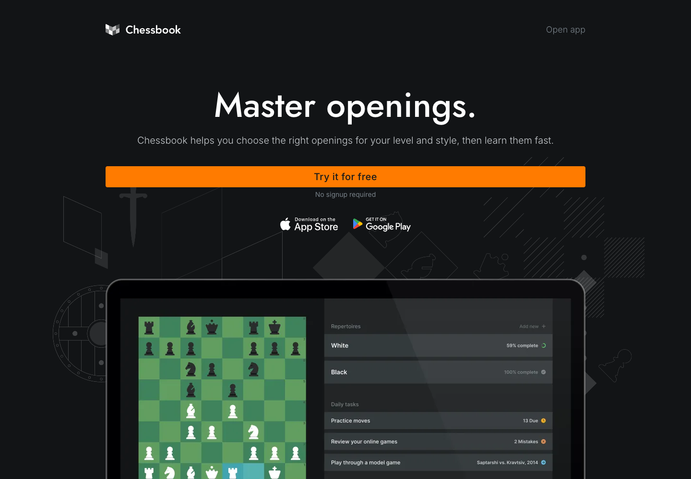
</p>

<h1 align="center">Chessbook</h1>

<h3 align="center">Master openings. Own your data.</h3>

<p align="center">
  A local-first recreation of <a href="https://chessbook.com/">Chessbook</a> — a real opening trainer with a production-grade shell, 3,865 ECO openings, spaced repetition, model games, and an installable PWA.
  <br />
  <strong>No accounts. No auth screens. No cloud. One SQLite file on your machine.</strong>
</p>

<p align="center">
  <a href="https://github.com/Abhinav-Prabhakar/chessbook-clone">
    
  </a>
  
  
  
  
  
  
  
</p>

<p align="center">
  <a href="#quick-start"><strong>Quick start</strong></a>
  &nbsp;·&nbsp;
  <a href="#screens"><strong>Screens</strong></a>
  &nbsp;·&nbsp;
  <a href="#architecture"><strong>Architecture</strong></a>
  &nbsp;·&nbsp;
  <a href="#install-it"><strong>Install as an app</strong></a>
  &nbsp;·&nbsp;
  <a href="#your-data"><strong>Your data</strong></a>
</p>

---

## Why it hits different

<table>
  <tr>
    <td width="33%" valign="top">
      <h3>♟️ A real training loop</h3>
      <p>Build lines, find the weakest branch, drill due moves, see the answer, and schedule the next review. Correct answers move to 3 days; mastered lines move to 30.</p>
    </td>
    <td width="33%" valign="top">
      <h3>🧠 Spaced repetition, built in</h3>
      <p>Every attempt updates mastery and due dates. Practice modes cover everything due, just your mistakes, every move, or one specific opening.</p>
    </td>
    <td width="33%" valign="top">
      <h3>🏠 Local-first by default</h3>
      <p>Your profile, repertoire, attempts, settings, and model-game progress live in one local SQLite database. There is no account server and no telemetry.</p>
    </td>
  </tr>
  <tr>
    <td width="33%" valign="top">
      <h3>🎨 Measured, not approximated</h3>
      <p>The board, breadcrumbs, sidebar, typography, spacing, and transitions were measured against the captured production UI. Even the row heights and column gutters match.</p>
    </td>
    <td width="33%" valign="top">
      <h3>🔊 The details matter</h3>
      <p>Move, capture, check, correct, and wrong sounds; piece-move animation; legal-move fades; animated progress bars; route fades; and a small confetti moment when a session ends.</p>
    </td>
    <td width="33%" valign="top">
      <h3>📱 Installable and offline-ready</h3>
      <p>A web manifest, maskable icons, iOS metadata, a service worker, and an offline shell. No custom install banner or modal — install from your browser or OS when you want it.</p>
    </td>
  </tr>
</table>

## A quick look

<p align="center">
  
</p>

<p align="center"><sub>Dashboard → practice → builder. Click any screenshot to open the full-size image.</sub></p>

## Screens

<table>
  <tr>
    <td width="50%">
      <a href="docs/assets/readme/dashboard.png">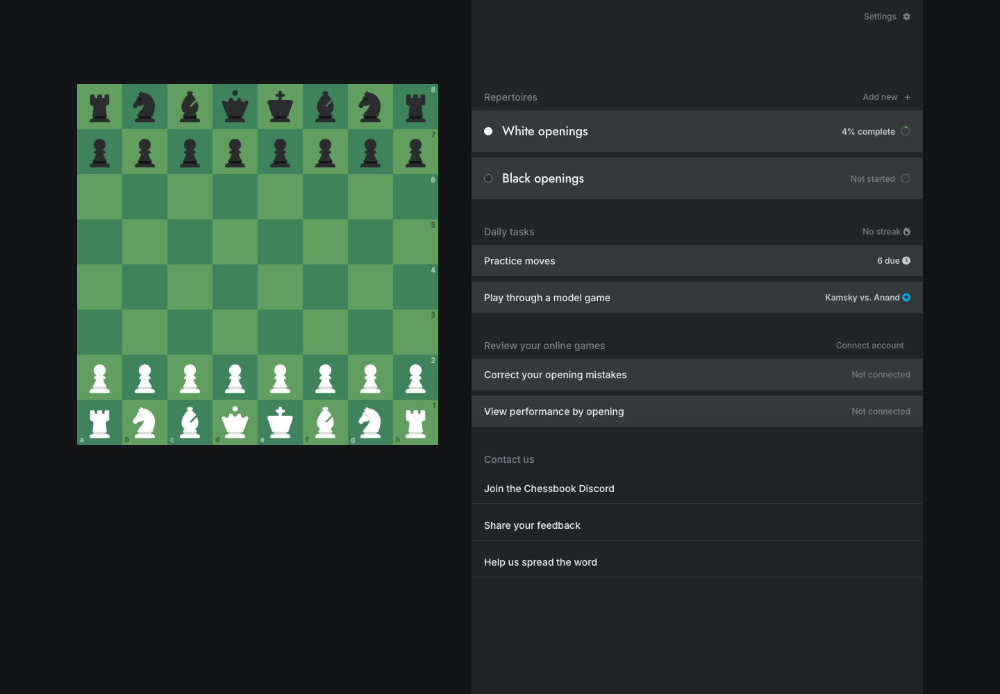</a>
      <p align="center"><sub><strong>Dashboard</strong> · repertoires, daily tasks, model games</sub></p>
    </td>
    <td width="50%">
      <a href="docs/assets/readme/repertoire.png">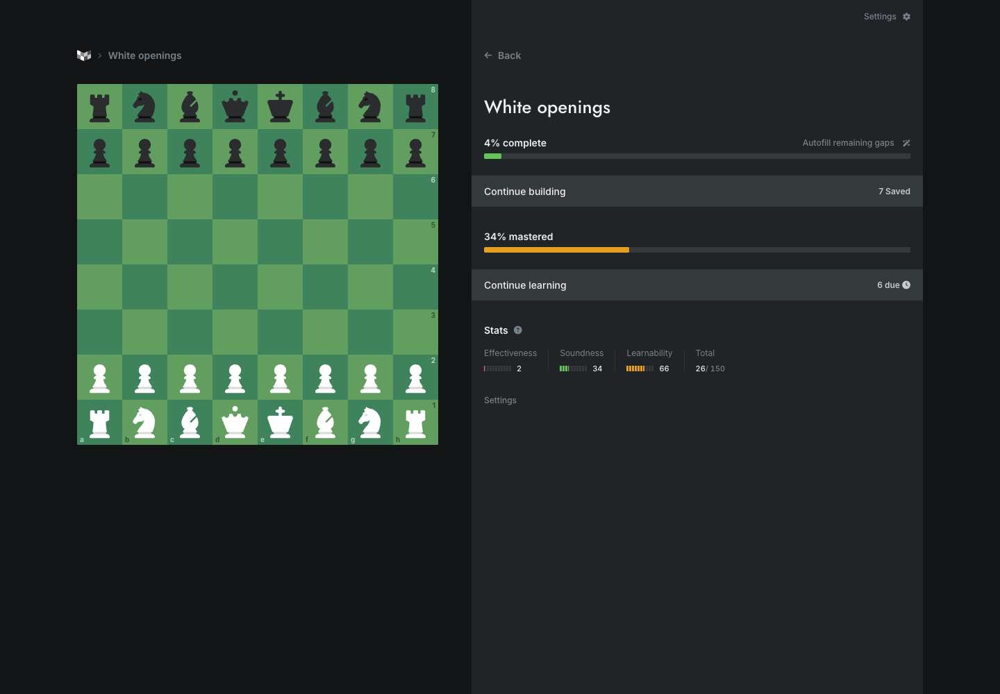</a>
      <p align="center"><sub><strong>Repertoire</strong> · coverage, mastery, and the next branch</sub></p>
    </td>
  </tr>
  <tr>
    <td width="50%">
      <a href="docs/assets/readme/build.png">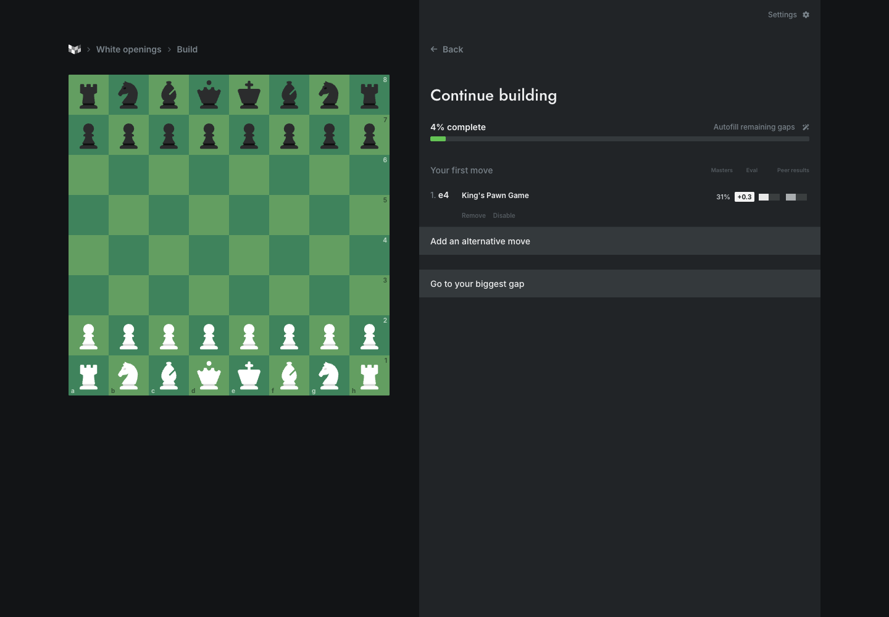</a>
      <p align="center"><sub><strong>Builder</strong> · candidate moves, stats, alternatives, gaps</sub></p>
    </td>
    <td width="50%">
      <a href="docs/assets/readme/practice.png">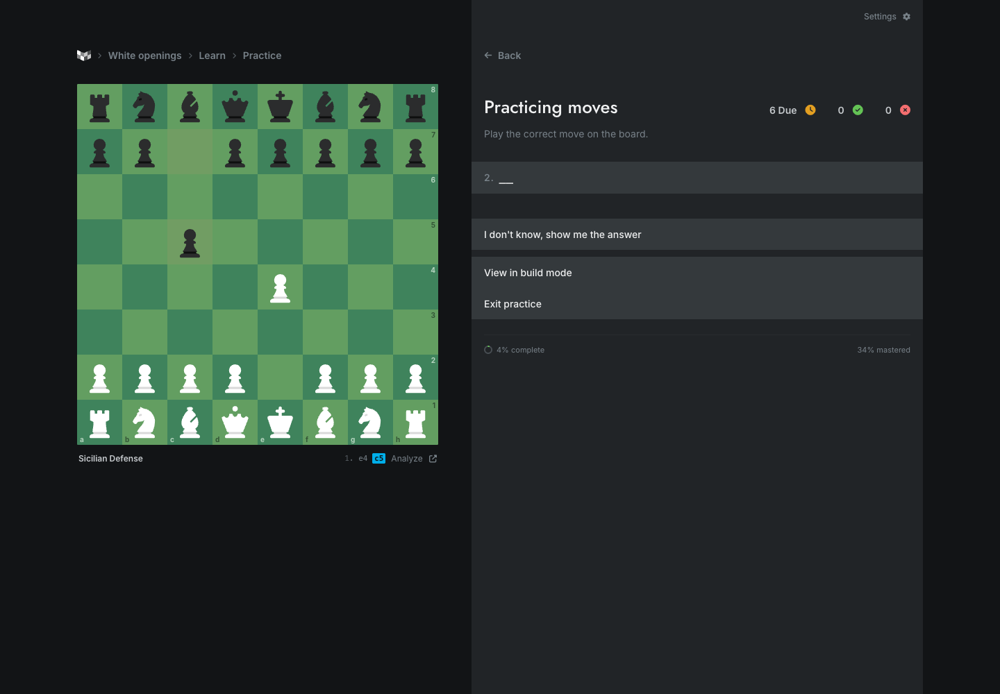</a>
      <p align="center"><sub><strong>Practice</strong> · legal-move dots, feedback, session score</sub></p>
    </td>
  </tr>
  <tr>
    <td width="50%">
      <a href="docs/assets/readme/learn.png">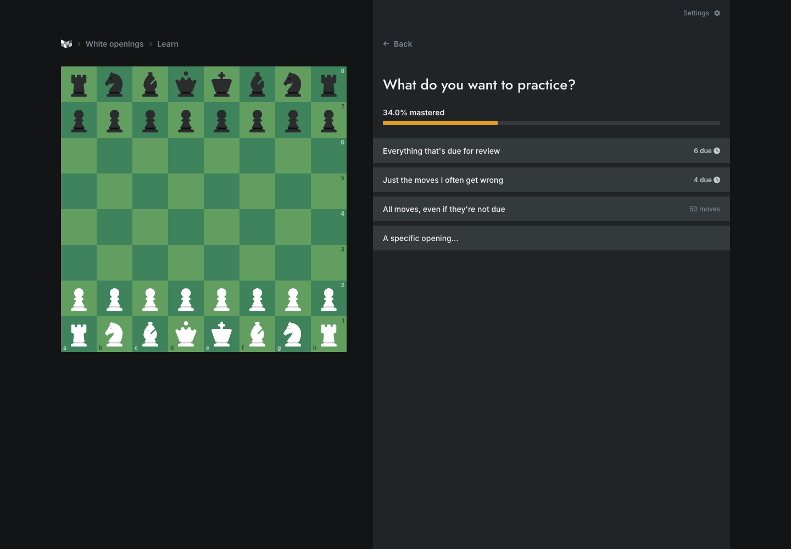</a>
      <p align="center"><sub><strong>Learn</strong> · due, mistakes, all moves, or one opening</sub></p>
    </td>
    <td width="50%">
      <a href="docs/assets/readme/model.png">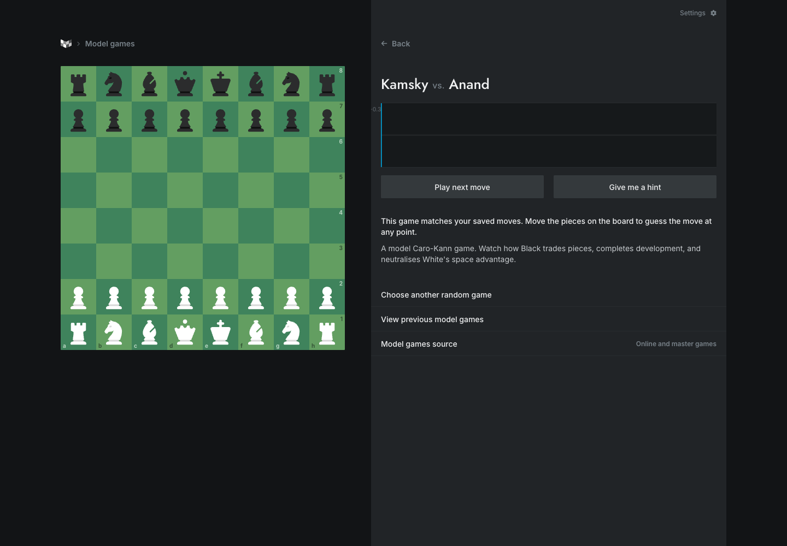</a>
      <p align="center"><sub><strong>Model games</strong> · annotated master games with hints</sub></p>
    </td>
  </tr>
  <tr>
    <td width="50%">
      <a href="docs/assets/readme/settings.png">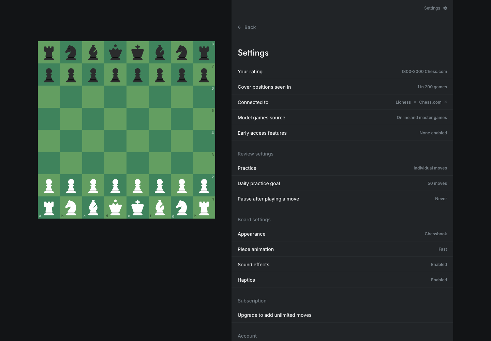</a>
      <p align="center"><sub><strong>Settings</strong> · rating, goal, theme, sound, and haptics</sub></p>
    </td>
    <td width="50%">
      <a href="docs/assets/readme/add.png">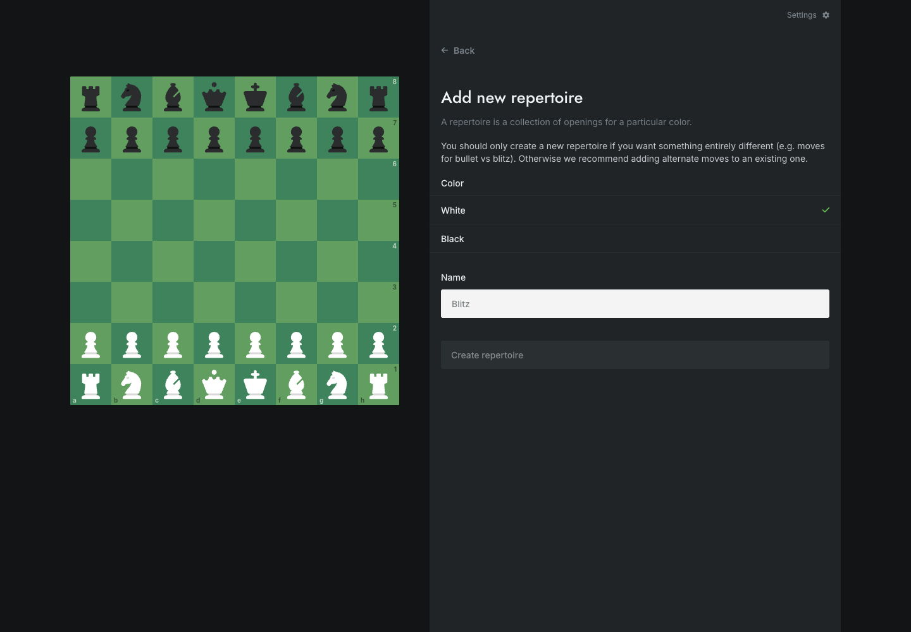</a>
      <p align="center"><sub><strong>New repertoire</strong> · pick a color, name it, start building</sub></p>
    </td>
  </tr>
</table>

<p align="center">
  <a href="docs/assets/readme/mobile.png">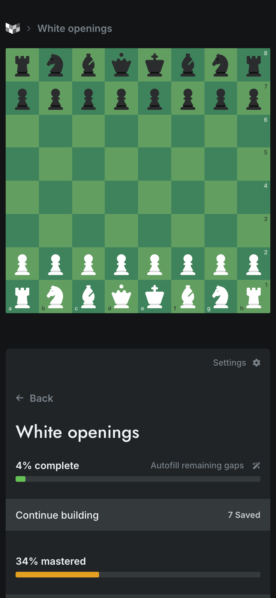</a>
</p>

<p align="center"><sub><strong>Mobile</strong> · the same shell, stacked for a phone</sub></p>

## Architecture

<p align="center">
  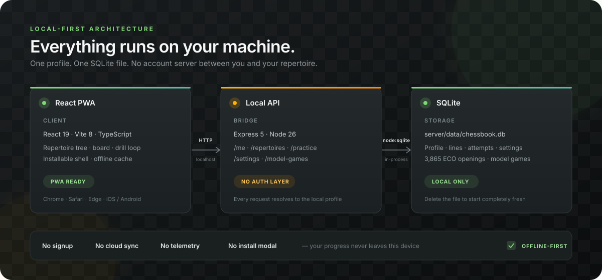
</p>

The entire app runs in two processes on one machine:

- **React PWA** — the board, repertoire tree, practice loop, model-game viewer, and settings UI.
- **Express API** — a tiny local bridge with no auth layer. Every request resolves to the one profile in `server/data/chessbook.db`.
- **SQLite** — repertoires, lines, attempts, spaced-repetition state, settings, openings, and model-game progress.

Nothing is uploaded. No analytics SDK, no remote auth, no third-party database.

## What works

- **Opening database** — 3,865 real ECO openings imported from the open-source [Lichess chess-openings](https://github.com/lichess-org/chess-openings) TSV set.
- **Repertoire builder** — walk from the first move through your repertoire branch by branch, compare candidate moves with mastery/eval/peer columns, disable or remove branches, autofill gaps, add alternatives, and import PGN.
- **Gap finder** — identifies the least-mastered line, shows candidate continuations from the position, and lets you add one directly.
- **Learn + practice** — due reviews, mistake reviews, all moves, or a specific opening; API-validated answers, wrong-move feedback, show-answer, per-session accuracy, and spaced scheduling.
- **Model games** — annotated master games with an evaluation graph, keyboard controls, hints, and saved progress.
- **Settings** — rating, coverage, practice mode, daily goal, board theme, piece animation, sound, haptics, and progress reset. Board preferences apply throughout the app.
- **Legal pages** — privacy, fulfillment, and terms.
- **Responsive layout** — desktop and mobile shells, including a mobile board/sidebar stack.
- **Installable PWA** — web manifest, maskable icons, offline shell, cached offline reads, iOS metadata, and a service worker. No custom install banner or modal.
- **Local persistence** — one local profile, repertoires, lines, attempts, settings, openings, and model games.

## Quick start

Requires **Node 26** (for the built-in `node:sqlite`) and npm.

```bash
git clone https://github.com/Abhinav-Prabhakar/chessbook-clone.git
cd chessbook-clone
npm install
npm run dev
```

- React/Vite: <http://localhost:5173>
- API/Express: <http://localhost:8787>

The Vite dev server proxies `/api`, `/_build`, `/homepage_imgs`, and `/pieces` to Express.

### Production

```bash
npm run build
npm start
# open http://localhost:8787
```

Express serves the built React app from `app/dist` and the shared production assets. The app is a single-page React experience; there is no `/signup` route.

## Install it

The PWA is installable on desktop and mobile from the production server:

1. Run `npm run build && npm start`.
2. Open <http://localhost:8787>.
3. Use **Install app** / **Add to Home Screen** from Chrome, Edge, Safari, or your OS.

The app deliberately does **not** show its own install banner or modal. A service worker caches the shell, icons, fonts, and previously opened API reads so the installed app still opens offline. Training writes still require the local API to be running.

## Your data

Everything lives in:

```text
server/data/chessbook.db
```

Reset the local profile and starter repertoires at any time:

```bash
npm run db:reset
```

The starter state is intentionally small and readable: 4% white completion, 34% mastery, 7 saved lines, and 6 lines due. The black repertoire is ready to start.

## Routes

| Route | Screen |
| --- | --- |
| `/` | First-run landing; dashboard once you enter |
| `/dashboard` | Dashboard |
| `/repertoire/:id` | Repertoire overview (also accepts `white`/`black`) |
| `/build/:id` | Builder tree (`?path=e4,c5`, `?line=…`, `?add=1`) |
| `/gap/:id` | Biggest-gap candidate finder |
| `/learn/:id` | Training mode selector |
| `/practice/:id` | Practice session (`?mode=due|weak|all`, `?line=…`) |
| `/model`, `/model/:id` | Model games |
| `/settings` | Settings |
| `/add` | Create a repertoire |
| `/legal/:kind` | Privacy, fulfillment, terms |

## Project layout

```text
app/
  src/
    pages/          React screens and the captured landing body
    components/     Board, sidebar/rows, toasts, confetti
    styles/app.css  production shell + component styles
    api.ts/profile.tsx/prefs.ts/chess.ts/sounds.ts
  public/           manifest, service worker, offline page, fonts, pieces, icons
  dist/             production build (generated)
server/
  api.js            local profile, repertoires, practice, settings, model games
  db.js             schema, opening import, seed data
  index.js          Express app + shared assets + SPA/PWA serving
  data/*.tsv        3,865 Lichess ECO openings
  reset.js          local database reset
docs/
  assets/readme/    screenshots, demo GIF, architecture diagram
```

The captured static pages are kept at the repository root as design references. The React app is the primary experience.

## Attribution

Opening data comes from the open-source [lichess-org/chess-openings](https://github.com/lichess-org/chess-openings) dataset. Chessbook branding, the captured page design, and the production shell belong to Chessbook. This is a study/portfolio recreation and is not affiliated with Chessbook.

<p align="center">
  <a href="https://github.com/Abhinav-Prabhakar/chessbook-clone">
    
  </a>
  
  
</p>
