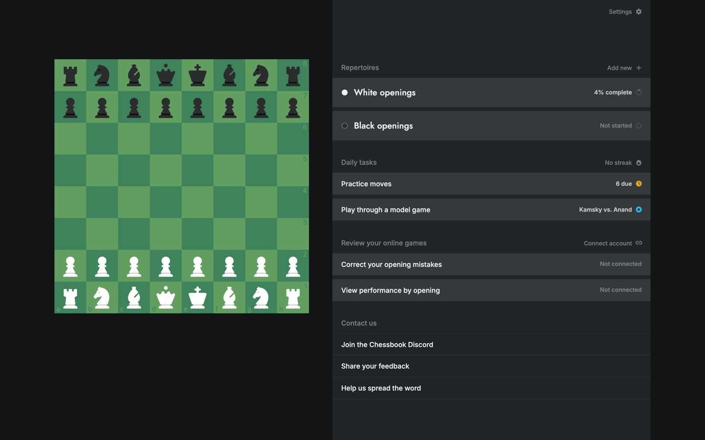
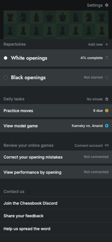

# Chessbook — static clone

A pixel-accurate, front-end clone of [chessbook.com](https://chessbook.com/), built as a static site from the real rendered application DOM and the original production CSS.

The goal of this project is **visual fidelity first**: every screen is captured from the live app, with its real layout, typography, colors, board pieces and CSS, then made navigable with a thin vanilla-JS interaction layer. There is no backend, account system or database.



## What is included

- **Desktop app screens** — dashboard, white/black repertoires, build, biggest gap, learn, practice, settings, model games, add-new.
- **Mobile app screens** — captured at 390 × 844 and served from `m/`; desktop pages redirect automatically below 768 px.
- **Auth/onboarding** — welcome tutorial and login screens, with the supplied demo credentials prefilled.
- **Marketing site** — the full signup/landing page at `signup/index.html`.
- **Legal pages** — privacy policy and fulfillment policy.
- **Working interactions**:
  - sidebar + breadcrumb navigation
  - back buttons per screen
  - practice board: select a piece, see legal moves, play `Nf3`, get correct/wrong feedback
  - “show me the answer” and “view in build mode”
  - autofill-gap flow
  - fake login/signup/logout navigation
  - toasts and move highlights
- **Premium/demo state unlocked** — the captured account is a logged-in Pro account with 4% white repertoire, 7 saved lines, 34% mastered, 6 due.



## Quick start

Any static file server works. From the repository root:

```bash
python3 -m http.server 4173
# open http://localhost:4173/
```

Or use the Node dev dependency:

```bash
npm install
npx serve .
```

The site is plain HTML/CSS/JS. There is no build step required to run it.

## Demo login

The login screen is prefilled with:

- **Email:** `local@chessbook.local`
- **Password:** `local-only`

Submitting the form (or pressing Enter) goes to the dashboard. No request is sent anywhere.

## Routes

| Route | Screen |
| --- | --- |
| `/index.html` | Dashboard |
| `/repertoire-white.html` | White repertoire overview |
| `/repertoire-black.html` | Black repertoire overview |
| `/build-white.html` | Build / line editor |
| `/gap-white.html` | Biggest gap |
| `/learn-white.html` | Learn |
| `/practice-white.html` | Practice session |
| `/settings.html` | Settings |
| `/model.html` | Model game |
| `/add.html` | Add new repertoire |
| `/welcome.html` | Onboarding tutorial |
| `/login.html` | Log in |
| `/signup/index.html` | Marketing / signup landing page |
| `/privacy-policy.html` | Privacy policy |
| `/fulfillment_policy.html` | Fulfillment policy |
| `/m/...` | Mobile versions of the app/auth screens |

## Project structure

```text
.
├── index.html … add.html      # desktop app screens (real captured DOM)
├── welcome.html, login.html   # auth screens
├── signup/index.html          # marketing page
├── privacy-policy.html        # legal pages
├── fulfillment_policy.html
├── m/                         # mobile captures (390 × 844)
├── _build/assets/             # original production CSS + fonts
├── pieces/chessbook_monochrome/  # piece SVGs
├── homepage_imgs/             # marketing imagery
├── js/boot.js                 # all clone interactivity
├── js/vendor/chess.js         # legal-move validation for the practice board
├── tools/build_pages.py       # regenerates pages from local snapshots
├── docs/                      # design system, site map, plan, handoff notes
└── legacy/                    # superseded hand-built first pass (not loaded)
```

## How it was built

1. **Capture**: the authenticated app was driven with Playwright at 1440 × 900 and 390 × 844; the rendered `#app` DOM was saved for each route.
2. **Localize**: production CSS bundles, fonts, piece SVGs, favicons and marketing images were downloaded locally.
3. **Generate**: `tools/build_pages.py` extracts the `#app` subtree, strips the framework hydration scripts, rewrites root-absolute URLs for GitHub Pages subpaths, injects navigation attributes, and writes the static pages.
4. **Animate/behave**: `js/boot.js` adds routing, auth-form behaviour, the practice board, toasts and feedback. It loads `chess.js` only on the practice page.

The raw capture workspace (`recon/`) is intentionally gitignored; the committed HTML is already generated. To regenerate from scratch you need those local snapshots and the original production assets.

## Deployment

The site is designed to work from a GitHub Pages project subpath (for example `/chessbook/`):

- All asset URLs are relative.
- `signup/index.html` uses `<base href="../">` so its marketing links resolve from the repo root.
- Desktop pages redirect to `m/<page>` under 768 px.
- The root-absolute URLs from production (`/pieces/`, `/_build/`, `/homepage_imgs/`, inline `url(...)` and `srcset`) are rewritten at generation time.

Deploy by pushing to a GitHub repository and enabling Pages on the `main` branch root.

## Testing

The local Playwright checks used during development live in `recon/` (not committed). They cover:

- desktop navigation across all primary flows
- mobile redirect + mobile navigation
- practice-board move validation and show-answer
- login/signup/welcome flows
- a simulated GitHub Pages subpath with zero 404s

## Known limitations

- Static UI clone only: no real authentication, repertoire editing, sync or persistence.
- Practice contains the captured position after `1.e4 c5` with `Nf3` as the expected move; other training content is presentational.
- The desktop DOM contains inline styles captured at 1440 px. That is why mobile screens are separate captures rather than a reflow of the desktop markup.
- Some production controls are intentionally inert; only the main navigation and training loop are wired.
- External links (Lichess analysis, social links, app stores) go to the real services.
- This is a study/portfolio clone, not affiliated with Chessbook.

## Design documentation

- [Design system](docs/design.md)
- [Site map](docs/SITE-MAP.md)
- [Build plan](docs/PLAN.md)
- [Handoff / context](docs/CONTEXT.md)
