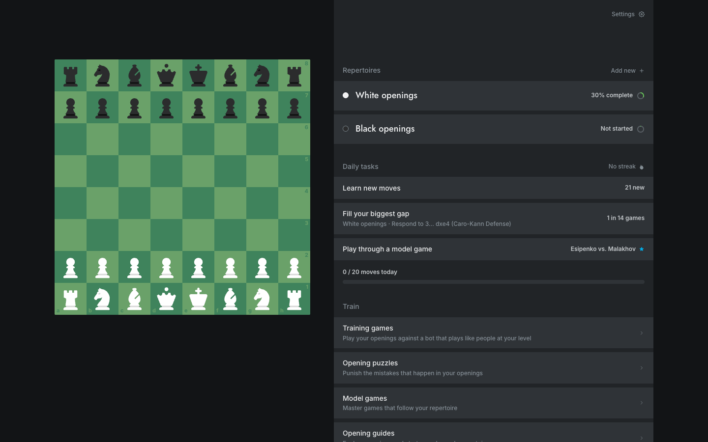
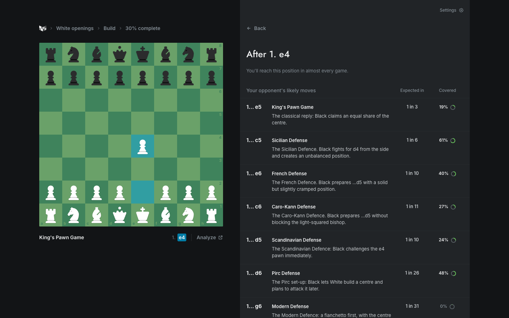
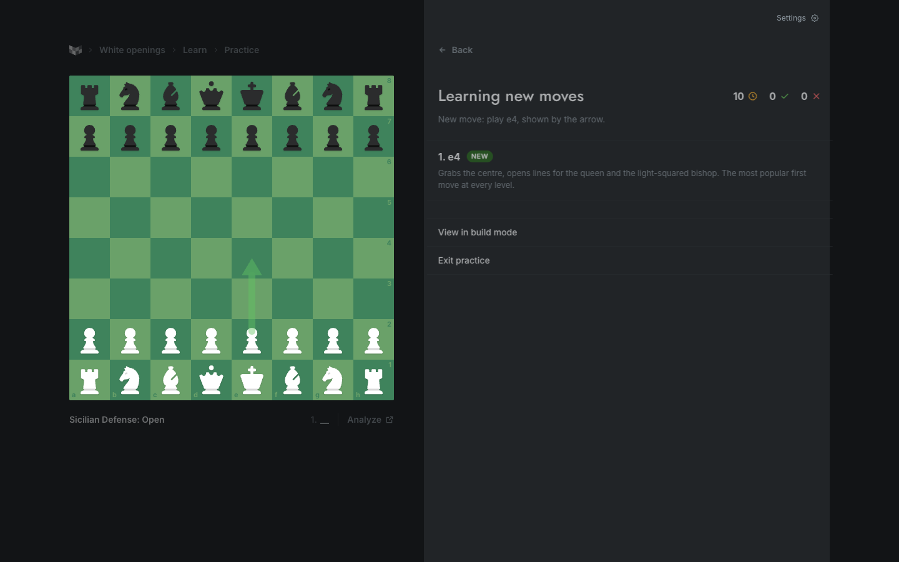

<p align="center">
  
</p>

<h1 align="center">Chessbook</h1>

<p align="center">
  Build, learn and practice your chess opening repertoire. A local recreation of
  <a href="https://chessbook.com">chessbook.com</a>: React + Express + SQLite, running entirely on your computer.
</p>

---

## What it does

- **Build** a repertoire for White and for Black. On your move, pick from the moves masters play, with engine
  evaluation and results at your rating. On your opponent's move, see the replies people at your level actually play
  and how often each comes up ("1 in 6 games"), and how much of each you've prepared.
- **Find your gaps.** Completion is the share of your games where your repertoire still has an answer, down to your
  coverage goal. The biggest gap is the position you'll reach most often without a prepared move. Autofill can close
  gaps with the main lines.
- **Learn and practice**, the way Chessbook does it. Each position's line is played for you, then you play your
  move(s). New moves are shown with an arrow first. A move outside your repertoire is judged by Stockfish: a good
  alternative is accepted, and a mistake is refuted on the board. Every move has its own spaced-repetition schedule.
- **Model games**: real master games that start the way your repertoire does. Guess the moves.
- **Puzzles** from real games in your openings (Lichess puzzle database).
- **Training games** against a bot that plays like people at a chosen rating, and tells you when the game leaves your
  repertoire.
- **Opening guides** that turn into a ready-made repertoire in one click; PGN import (with variations) and export.

No account, no subscription, nothing uploaded.

<p>
  
  
</p>

## Quick start

Requires **Node 26** (built-in `node:sqlite`).

```bash
npm install
npm run dev
```

Open <http://localhost:5180>. The API runs on port 8787 and Vite proxies to it.

The first start imports the bundled opening data (about 10 seconds) and then loads 45,000 master games in the
background (about a minute) for model games.

### Production

```bash
npm run build
npm start
```

Then open <http://localhost:8787>.

### Scripts

| Command | What it does |
| --- | --- |
| `npm run dev` | API and Vite dev server |
| `npm run build` | Builds the app into `app/dist` |
| `npm start` | Serves the built app and the API on port 8787 |
| `npm test` | API tests on a throwaway database |
| `npm run test:e2e` | Browser test of the learning loop (needs `npm run build` and Google Chrome) |
| `npm run db:reset` | Deletes the local database; it is recreated on the next start |
| `npm run data:lichess`, `data:masters`, `data:puzzles` | Rebuild the bundled datasets from their sources |

## Data

| Data | Source |
| --- | --- |
| Moves and results at your level | Lichess open database, September 2026: 3.2 million rated blitz, rapid and classical games, split by rating (CC0) |
| Masters column | 434,258 games by 250 strong players from the PGN Mentor archives |
| Model games | 45,000 complete games between strong players |
| Puzzles | 39,030 Lichess puzzles from opening positions, tagged by opening (CC0) |
| Opening names | Lichess chess-openings (CC0) |
| Evaluations | Stockfish 19, running locally |
| Move explanations | Written for this app |

The datasets are compressed in `server/data/` (about 16 MB) and imported into `server/data/chessbook.db` on first
start. The scripts in `server/tools/` rebuild them; downloads are cached in `~/.cache/chessbook-data/`.

## How it is built

```text
server/
  index.js            Express app, data import on start-up
  core/
    db.js             SQLite schema
    data-import.js    imports the bundled datasets
    explorer.js       move statistics (masters, players by rating band), opening names
    repertoire.js     the move graph: add, remove, paths
    coverage.js       completion, gaps, autofill
    practice.js       sessions, reviews, daily progress, streaks
    srs.js            FSRS scheduler
    model-games.js    matching master games to your repertoire
    puzzles.js        puzzle selection and rating
    training.js       the bot
    api.js            HTTP routes
  engine.js           Stockfish worker
  tools/              dataset build scripts
app/src/
  board/              the board and the shared board "stage"
  shell/AppShell.tsx  layout: one persistent board + sidebar
  pages/              screens
tests/                API tests and the browser test
```

The board is rendered once by the app shell and pages tell it what to show (`useBoard`), so navigating never
redraws it: pieces slide to the new position.

See [STATUS.md](STATUS.md) for what changed from the previous version, how it was verified and the known limits.

## Attribution

Opening statistics and puzzles from the [Lichess open database](https://database.lichess.org/) (CC0). Opening
names from [lichess-org/chess-openings](https://github.com/lichess-org/chess-openings) (CC0). Master games from
[PGN Mentor](https://www.pgnmentor.com/files.html). [Stockfish](https://stockfishchess.org/) (GPLv3). Piece sets:
see `pieces/README.md`. Chessbook's name and design belong to Chessbook; this is a personal study project and is
not affiliated with them.
